# The Adventures of Robin Lloyd (PlayStation) English translation v1.0.1

An unofficial fan translation patch for **Robin Lloyd no Bouken** (ロビン・ロイドの冒険).
It contains only the changes to the game's data track, not the game: you need your own
disc image of **Robin Lloyd no Bouken (Japan)**, the Redump version.

**[Download the patch (v1.0.1)](https://github.com/suddenlythis/robinlloyd-psx-english/releases/tag/v1.0.1)**
 · [How to install](INSTALL.md) · [Checksums](SHA1SUMS.txt)

  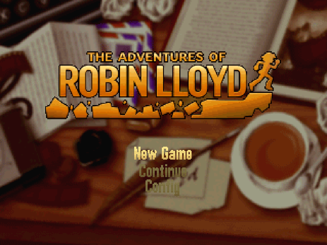

## Progress

Version 1.0.1: everything in the game is translated.

| Area | Status | Details |
|---|---|---|
| English font and text system | Done | A new 8-pixel Latin font. Two English letters are drawn in the space of one Japanese character |
| Dialogue | Done | All 987 lines: the prologue, both cases, the interludes and the ending |
| Item names and descriptions | Done | Both chapters, in the item menu and in the text boxes |
| Menus and prompts | Done | Title menu, config, save and load screens, memory card messages, Examine / YES / NO prompts, the Use / Look buttons |
| Title logo | Done | Redrawn in English in the style of the original logo |
| Text in pictures | Done | Images with Japanese text were recreated in English: the item menu labels and buttons, Ryile's hand-written notes, the chapter title cards, the title menu, the config labels, the save and load messages and the newspaper on the load screen |
| Action stages | Done | Mission objectives, battle chatter in all seven stages, the GAME OVER prompt, the tank stage tutorial line |
| Tested on | DuckStation | Not tested on other emulators or on real hardware |

## About the game

Robin Lloyd no Bouken is a detective adventure game for the PlayStation.

| | |
|---|---|
| Released | 1999, Japan only |
| Developer | Gust, with Winds (as named in the game's credits) |
| Product code | SLPS-02501 |
| Ending theme | 君と見上げる空 ("The Sky I Look Up at with You") |

**The story.** Robin Lloyd is an 18-year-old detective in London ("the best", by his own
account) with his dog and assistant, Butler, and his landlady Elice, a university
lecturer whose inventions supply his secret weapons. Alicea Garfield, heiress to the powerful
Garfield Foundation, comes to his office: her fiancé, the adventurer-archaeologist
Ryile Rockwood, has gone missing while searching for the "Rose of Awakening", the
jewel without which the Kingdom of Kyle cannot crown its new queen. The game has two
cases: **The Museum Case**, at Sarsperlow Museum by day and by night, and
**The Shipwreck Case**, aboard the pirate ship Smasher at Seabird Reef. Colonel Doil
and his men are never far behind.

**How it plays.** You walk around the rooms, talk to people and examine things up
close, collect items and use them to solve puzzles. Between the investigations come
short action stages against Doil's machines.

## Screenshots

| | |
|---|---|
| 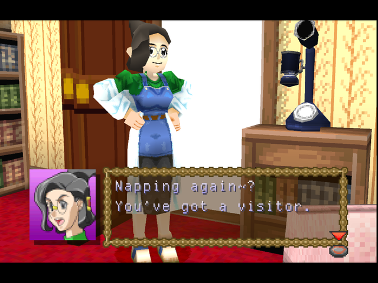 | 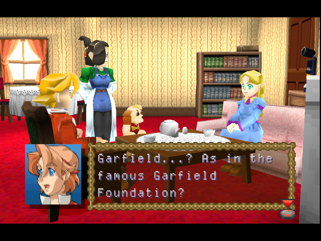 |
| 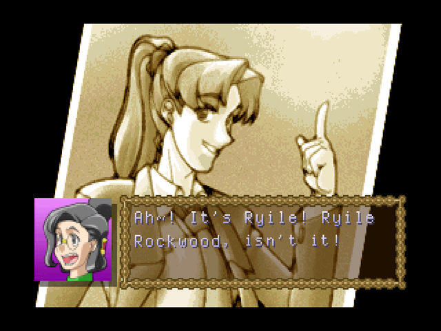 | 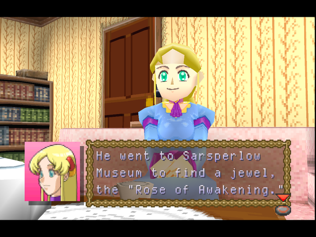 |
|  | 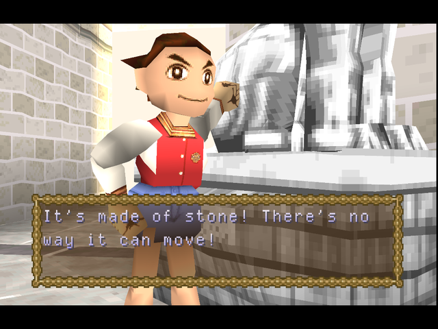 |
| 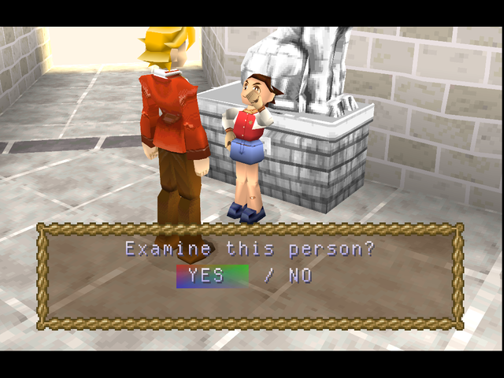 | 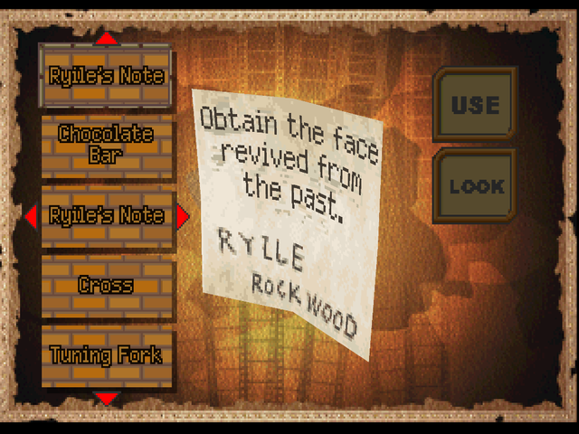 |
| 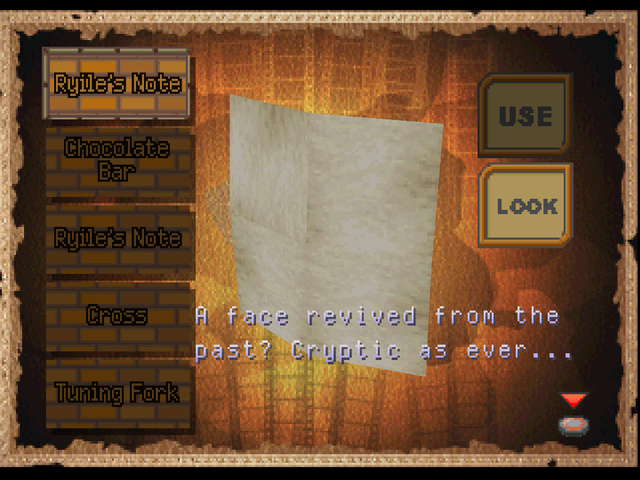 | 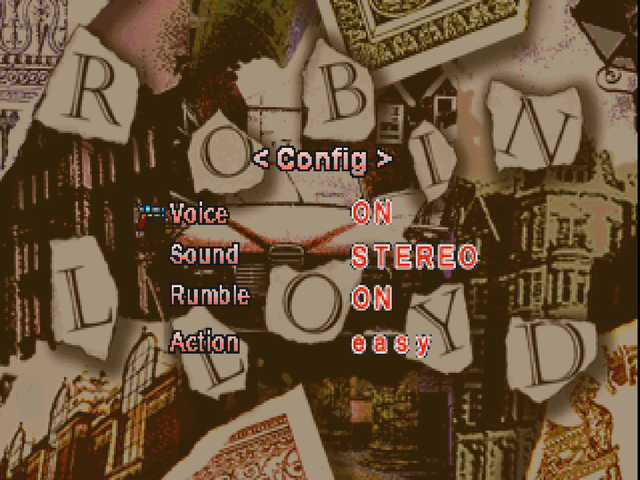 |
| 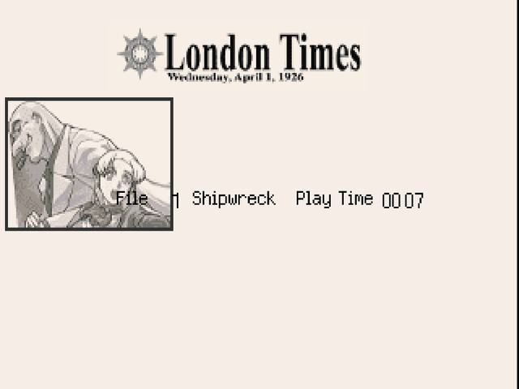 | 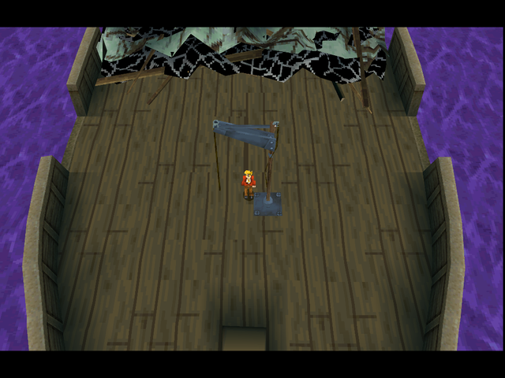 |
| 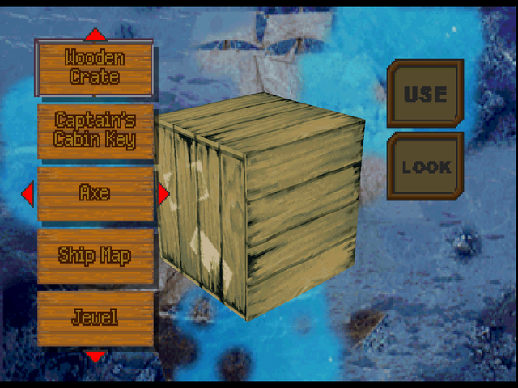 |  |

## Installing

You need the Redump version of the disc, **Robin Lloyd no Bouken (Japan)** (SLPS-02501).
Its Track 1 must be 206,710,224 bytes with SHA-1
`4c68776b4a98b9af4c62a691102009827207ce16`.

Short version: patch **Track 1** of your disc image with the `.xdelta` file, keep the
file name, and open your usual `.cue`. Track 2 (the CD audio) is not changed.

Full instructions, with the checksums to verify your image and the result, are in
[INSTALL.md](INSTALL.md).

Start a new game or load an in-game save after patching, rather than loading a save
state made on the Japanese game.

## About this translation

The script was translated from the game's own Japanese text. The aim was a natural,
faithful localization that keeps every puzzle clue working in English.

Names and details. Names are spelled the way the game's own English artwork and the
original Japanese instruction manual write them in Latin letters: Robin Lloyd,
Butler, Elice, Alicea Garfield, Ryile Rockwood and Colonel Doil. The character
descriptions in this readme and the controls in the install guide also follow the
manual.

AI was used to assist with the code and translation.

## What is in English

- All dialogue, examinations and story scenes, with each character's voice kept:
  Robin's wry asides, Butler's lines in parentheses, Doil's bluster.
- Item names in the item menu (32) and every item description.
- The title menu, both config screens, the save and load screens and every memory
  card message.
- The Examine and YES / NO prompts, and the Use / Look buttons in the item menu.
- Ryile's four hand-written clue notes, both as items and in the scenes where they
  are found.
- The chapter title cards ("The Museum Case", "The Shipwreck Case").
- The newspaper headline on the load screen.
- The action stages: the mission objectives, the battle chatter of all seven stages,
  the GAME OVER prompt and the tank stage's camera instruction.
- The title logo, redrawn as "The Adventures of Robin Lloyd" with a running detective
  and a broken skyline, like the original.

## What was changed in the game

Nothing about the story, the puzzles, the difficulty or the content was changed.

Text
- The game draws text from small per-scene fonts that hold only the Japanese
  characters each scene needs. The patch replaces that lookup with a routine that
  draws two letters from a new 6 x 10 Latin font in each character cell, so a line
  holds twice as many letters as before.
- Every line is word-wrapped to fit the game's three-line text box.

Pictures
- Every image that contained Japanese text was recreated in English: the title logo,
  the title menu, the item names and the Use / Look buttons in the item menu, Ryile's
  notes, the chapter title cards, the config labels, the save and load messages and
  the action-stage graphics.
- The game stores these pictures compressed in two formats. Both were decoded and the
  edited pictures were compressed again to exactly their original size, so nothing
  else on the disc moves.
- The chapter title cards flash the title one character at a time. They now flash
  three or four English words instead of thirteen or fourteen kanji.
- The "Vibration" label on the config screen was given a slightly wider space so
  that "Rumble" fits.

## Not translated

- The staff credits.
- The name the game gives its save file in the PlayStation's own memory card screen.
- Two crates on the pirate ship with the stencil 大吉 ("great luck"), and the Japanese
  prints in the museum's Oriental room, which are part of the scenery.

## Known issues

- In the item menu, the labels slide sideways when you change page or switch between
  Ryile's notes, and for a moment a label shows part of its neighbour. The original
  game does the same.

## Technical

- One file of the disc image is changed: Track 1, the data track. Track 2, the CD
  audio, is untouched.
- The patched track is the same size as the original, and sector error-correction
  data is recomputed for every changed sector.
- The patch is made against the Redump image (Track 1 SHA-1
  `4c68776b4a98b9af4c62a691102009827207ce16`) and refuses any other file.
- Save states made on the Japanese game keep the old program in memory. In-game saves
  work with both versions.
- Tested on DuckStation. Not tested on other emulators or on real hardware.

## Version history

| Version | Date | Notes |
|---|---|---|
| v1.0.1 | 2026-11-21 | Fixes a possible freeze in dialogue while speaking to a character in a cell |
| v1.0 | 2026-11-20 | First release. Full script, menus, item names, pictures with text, action stages, English title logo |

---

This is an unofficial, non-commercial fan work. Robin Lloyd no Bouken and everything
in it belong to their owners. The patch contains no game data that can be used without
an original disc image.
